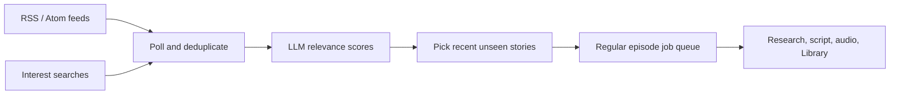

# Automatic episode generation

## Implemented in 1.10.0

PodWave can watch RSS/Atom feeds and news searches based on an interest list, then make a
non-fiction digest on a daily or weekly schedule. Configure it under **Settings → Automatic
episodes**. It is disabled by default.

### Settings

- **Interests:** one search query per line. Searches use Tavily and run only when a Tavily key
  is configured.
- **RSS / Atom feeds:** one HTTP(S) feed URL per line. Feed polling does not need a search key.
- **Schedule:** daily or weekly, at a selected time on the server's local clock. Weekly schedules
  also choose a weekday. The scheduler runs while the server is running.
- **Stories, length and relevance:** choose 1–6 stories, 2–45 minutes and a minimum score from
  0–10. Defaults are two stories, ten minutes and a score of five.

Save the settings to start the scheduler. It polls every three hours by default, scores unseen
items with the selected LLM, and queues the top eligible stories at the scheduled time. URLs are
deduplicated, and items are kept in the local SQLite database so they are not repeated. If a
provider error prevents scoring, those items are retried on a later poll. If no recent item
meets the score threshold, PodWave skips that scheduled episode. Queued episodes use the normal
job controls and show in Library after completion.

### Requirements and limits

- The server needs to stay running for polling, scheduling and generation.
- Interest searches require a working Tavily key. Feed-only schedules work without it.
- The selected LLM is used for relevance scoring; ordinary nonfiction research still uses the
  configured Tavily search provider. Without a search key, the regular episode pipeline notes
  that it is using model knowledge.
- Auto-generated digests are queued automatically; there is no approval inbox in this version.
- Feeds and the seen-item index are stored locally. Disabling automation stops polling and new
  scheduling but keeps already queued jobs and seen-item history.
- PodWave's `/api/*` endpoints have no authentication. Bind the server only to a network you
  trust; a configured feed URL is fetched by the server.

## Follow-up ideas

The initial implementation can grow into an editable review inbox, per-source polling intervals,
story clustering across feeds, follow-up detection against older episodes, quiet hours, multiple
show profiles, an RSS podcast output feed and notifications when a new episode is ready. These are
not implemented yet.
